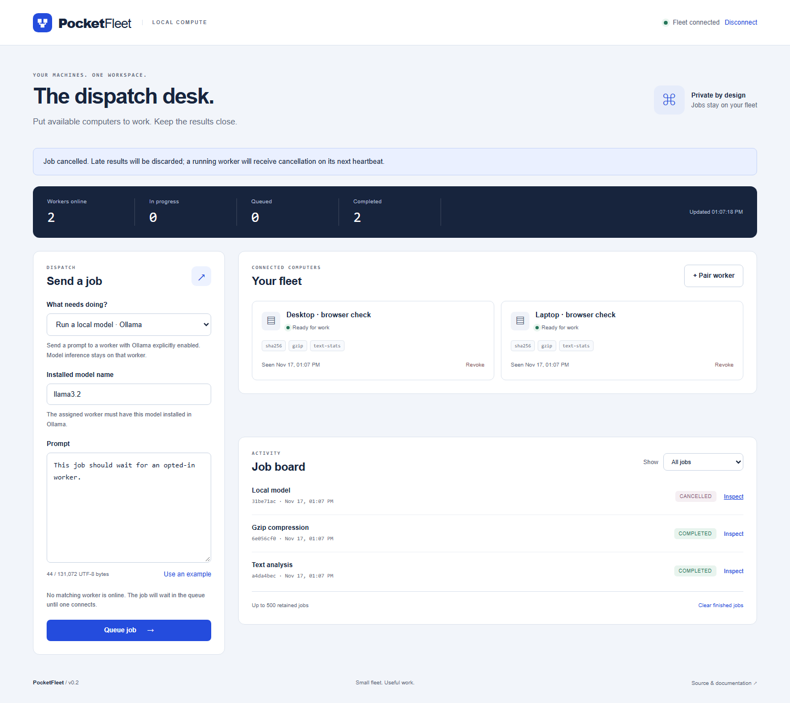

# PocketFleet

**Run a private job queue on computers you own.** Try two workers on one machine with Node.js 22.12+:

```sh
npx --yes --package=https://github.com/alfonza1/pocketfleet/releases/download/v0.3.0/alfonza1-pocketfleet-0.3.0.tgz pocketfleet demo
```

Open the loopback URL printed in your terminal and use the temporary token to sign in.
One worker counts the words in a sample log. A second compresses it into a downloadable
gzip file. Try another job, then press Ctrl+C to stop both workers and remove the demo
state. Add `--once` for a terminal-only run that verifies both results and exits.
From a source checkout the same command is `node src/cli.mjs demo`.

[Website](https://alfonza1.github.io/pocketfleet/) · [Quick start](#quick-start) · [Architecture](docs/architecture.md) · [Security](SECURITY.md)

PocketFleet is a small capability-based job queue for trusted personal machines.
It runs without cloud accounts, databases, containers, or runtime npm dependencies.
Agents can submit jobs through the CLI or HTTP API; people can use the dashboard.



## What you can run

- Pair up to 32 workers with expiring, single-use codes and revocable credentials.
- Dispatch UTF-8 text analysis, SHA-256 hashing, and gzip compression.
- Run local-model prompts on workers explicitly connected to an existing Ollama server.
- Queue work by capability, inspect results, download gzip artifacts, cancel jobs,
  and clear completed history from the dashboard.
- Persist jobs and pairing state across coordinator restarts.
- Use HTTPS between machines, with an explicit trusted-LAN HTTP opt-in.

This release handles independent, bounded text jobs. It does **not** split a model
across GPUs, discover your network automatically, execute arbitrary shell commands,
or claim to sandbox untrusted workers. Pair only machines you control. The hash and
compression adapters are useful for proving dispatch; Ollama is the optional heavier workload.

## Quick start

Requires **Node.js 22.12 or later**. Windows PowerShell, macOS, and Linux are supported.
There is no npm registry release yet; install from GitHub or use the source directly.

```powershell
git clone https://github.com/alfonza1/pocketfleet.git
cd pocketfleet
node src/cli.mjs init
node src/cli.mjs token
node src/cli.mjs serve
```

Open **http://127.0.0.1:4320** and paste the token displayed by `token`.
Click **Pair a worker**, then run the generated command in a second terminal.
The pairing code expires after five minutes and is consumed once.

```powershell
node src/cli.mjs worker --server http://127.0.0.1:4320 --code YOUR_PAIRING_CODE --name desktop
```

Submit a task from the dashboard. To connect a second worker on the same machine,
generate a new pairing code and use `--dir .worker-two` so its credentials are separate.
An existing worker reconnects without `--code` using the same `--dir` and `--server`.

Optional command installation:

```powershell
npm install --global https://github.com/alfonza1/pocketfleet/releases/download/v0.3.0/alfonza1-pocketfleet-0.3.0.tgz
pocketfleet --help
```

### Submit from your agent or terminal

```powershell
node src/cli.mjs submit --kind text-stats --text "One task. Several useful machines."
node src/cli.mjs submit --kind gzip --file README.md
node src/cli.mjs status
```

Use `POCKETFLEET_TOKEN` for an API client outside the coordinator directory.
Never put tokens in URLs, source files, screenshots, or shared command history.
See [the API contract](docs/api.md) for direct integration.

### Use a second physical computer

By default the coordinator is loopback-only. Supply your own trusted TLS certificate
and key to listen on a private interface:

```powershell
node src/cli.mjs serve --host 0.0.0.0 --cert fleet-cert.pem --key fleet-key.pem
node src/cli.mjs worker --server https://YOUR_PRIVATE_HOST:4320 --code YOUR_PAIRING_CODE --name spare-pc
```

Run the worker command on the second machine. Install the certificate authority on
that machine, or point Node's `NODE_EXTRA_CA_CERTS` at your CA file. Never disable
certificate verification. The hostname must match the certificate.

For an isolated trusted LAN, HTTP is available only when **both** commands explicitly
include `--allow-insecure-lan`. HTTP exposes credentials and task contents to network
observers. Do not expose this service to the public internet. Adjust your firewall
yourself to allow only the intended private machines; PocketFleet changes no firewall rules.

### Optional local AI

Install and run Ollama yourself, with an existing model. PocketFleet never downloads
models or sends prompts to a cloud provider. Enable the adapter when pairing:

```powershell
node src/cli.mjs worker --server http://127.0.0.1:4320 --code YOUR_PAIRING_CODE --name ai-pc --ollama http://127.0.0.1:11434
node src/cli.mjs submit --kind ollama --model YOUR_INSTALLED_MODEL --text "Summarize the advantages of local job dispatch."
```

Only the worker owner controls the Ollama endpoint, and it must be loopback.
Reconnect with the same `--ollama` setting. Prompts and outputs are stored in the
coordinator's local state, so treat that directory as sensitive.

## Reliability and limits

One job runs per worker. A worker renews its lease every three seconds. After a
20-second lost lease, or a two-minute absolute deadline, a job fails with an explicit
unknown-outcome/deadline message. Jobs are never automatically retried: this prevents
an ambiguous interruption from silently running work twice. Cancellation prevents a
late result from being accepted and aborts an in-flight model request where possible.
The model server may continue computation after a connection closes.

After an unclean shutdown, startup may report an existing `coordinator.lock`. Confirm
the PID recorded there has stopped before removing that file. Never remove the lock
while a coordinator still uses the directory; automatic stale-lock recovery is avoided
because simultaneous restarts can race.

Limits live in [`src/config.mjs`](src/config.mjs): 128 KiB input, 512 KiB result,
500 retained jobs, 16 MiB total state, 32 active workers, 16 pending pairing codes. Clear terminal jobs
to free history space. Values are intentionally small for a personal fleet.

## Recovery and reliable clients

Inspect local state without displaying credentials:

```powershell
node src/cli.mjs doctor
```

Back up a running coordinator to a new file, then restore only after stopping it:

```powershell
node src/cli.mjs backup --file .pocketfleet/snapshot.backup.json
# Stop the coordinator before this command. Existing state is preserved separately.
node src/cli.mjs restore --file .pocketfleet/snapshot.backup.json --replace
```

Keep `config.json` separately protected: restoring an archive requires its original
coordinator credentials. Backups contain private job data. They never overwrite an
existing archive. Restore removes old workers/pairing codes and fails historical queued
or running jobs, so stale work cannot silently execute again. Re-pair workers and submit
new jobs explicitly. See [operations](docs/operations.md) for recovery steps and limits.

For a submission you may need to retry, choose a stable key for that logical request:

```powershell
node src/cli.mjs submit --kind text-stats --text "hello fleet" --idempotency-key report-001
```

Repeating the same request/key returns the original job while it remains in history.
Changing the request requires a new key. Clearing history also clears its deduplication
record. The dashboard handles keys automatically for unchanged retries after errors.

## Development

```powershell
npm ci
npm test
npm run lint
npm run build
npm run dev
```

Development tools require Node 22.13+ or 24+. `lint` runs ESLint's recommended checks;
`build` syntax-checks the native JavaScript modules. No transpilation or TypeScript
type-checking is claimed. The test suite exercises real HTTP dispatch,
authentication separation, lease expiry, cancellation, persistence, and real gzip
artifacts. The Ollama protocol test uses a clearly labelled HTTP fixture server.

Browser verification instructions and runtime evidence are in [verification](docs/verification.md).
For the browser checks, run `npx playwright install chromium`, then `npm run test:e2e`.
The hosted website is a static introduction; the actual coordinator and workers run
on your computers. See [contributing](CONTRIBUTING.md) for focused adapter contributions.

## Why this exists

Local AI and personal agents make spare compute useful again. PocketFleet explores
the smallest practical piece: explicit worker capabilities, bounded jobs, and returned
artifacts. [exo](https://github.com/exo-explore/exo) focuses on local distributed inference;
[Ray](https://github.com/ray-project/ray) provides a broader distributed runtime.
PocketFleet trades that breadth for a lightweight, inspectable personal job fleet.

MIT licensed. No telemetry.
