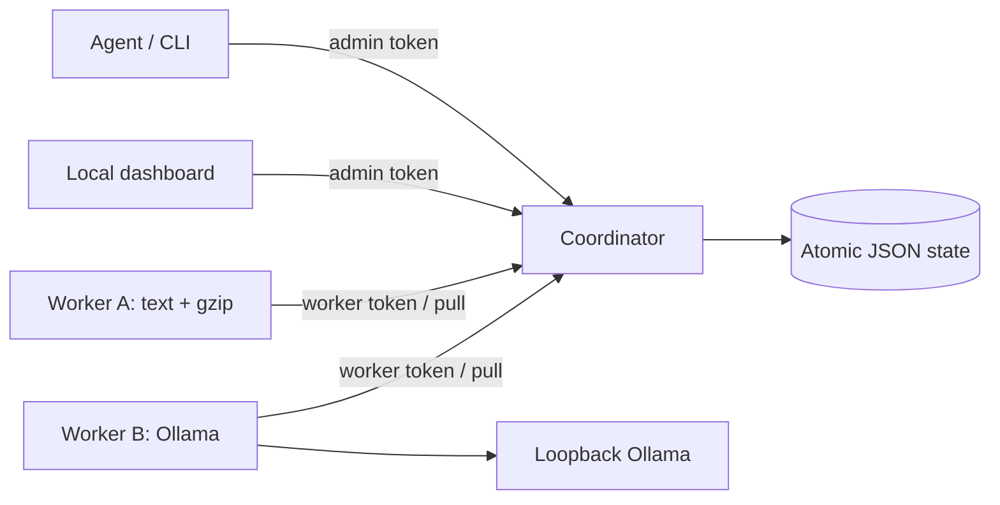

# Architecture

The coordinator is a single Node process serving a static dashboard and an HTTP API.
Workers pull jobs; the coordinator never connects to workers. This keeps worker ports
closed and gives each machine an explicit list of available adapters.

## State machine

`queued → running → completed | failed | cancelled`; queued jobs can also be cancelled.
A claim atomically assigns a worker, a fresh lease token, and an absolute deadline.
All mutations occur synchronously within the Node event loop and are persisted using
write-to-temporary-file followed by rename. A process lock prevents two coordinators
from sharing a directory. This is a single-host persistence strategy, not an HA database.
Files are not fsynced; sudden power loss can lose the most recent write. Keep backups.
Idle polling and heartbeats update in-memory presence/leases without rewriting history.
On disk-write failure the mutation is rolled back and dispatch stops until restart.
Total serialized state is capped at 16 MiB. The dashboard polls summaries and fetches
individual payloads/results on inspection, avoiding repeated artifact downloads.

Only the assigned worker with the current lease can heartbeat or complete a job.
Cancelled, expired, or interrupted jobs reject late completion. Restarted coordinators
fail jobs that were running rather than assuming they can safely replay them.
There is no exactly-once execution promise across crashes or network partitions.

## Trust boundaries

Admin tokens and worker tokens are separate. State stores token hashes, while each
machine's local credential file contains its own plaintext token. Pairing codes are
256-bit secrets, hashed at rest, single-use and valid for five minutes. The administrator
can revoke a worker immediately. A paired worker is trusted to compute truthful results;
cryptographic authentication does not verify the content of the result.

The dashboard sends same-origin requests, keeps its token in session storage, renders
job content as text, and uses a restrictive CSP. Cross-origin requests are rejected.
The server has bounded headers, body sizes, rate limits, and explicit static asset routes.

## Adapter boundary

The job payload is data, never executable code. SHA-256, gzip, and text statistics
use Node standard libraries. Ollama is opt-in at worker enrollment, accepts only model
and prompt, and calls an owner-configured loopback endpoint with bounded output and timeout.
No worker can change a submitted job's kind or payload through the API.

## Extending

Add an explicit adapter name, strict payload validation, execution logic, and a UI input.
An adapter must accept cancellation, bound resources, produce JSON-serializable results,
and document side effects. Add capability dispatch and artifact tests. Do not introduce
an unrestricted command adapter; the personal-trust model still benefits from constrained
execution. Resource isolation for heavier adapters is a future architecture change.
